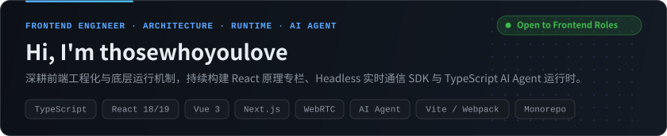
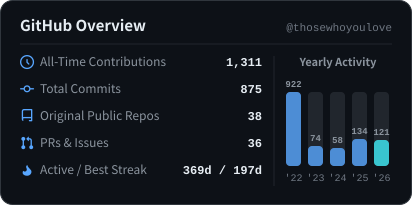
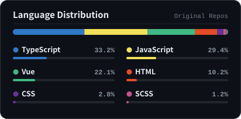
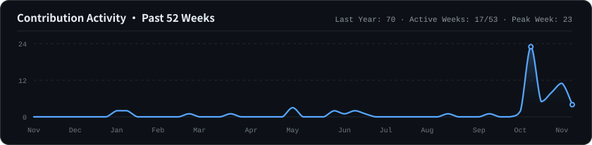

<picture>
  <source media="(prefers-color-scheme: dark)" srcset="./profile/banner-dark.svg" />
  <source media="(prefers-color-scheme: light)" srcset="./profile/banner-light.svg" />
  
</picture>

 

---

### About Me

- **前端工程与底层机制**：主力技术栈为 **TypeScript / React / Vue**，深入研究 React Fiber 并发渲染、Hooks 调度模型与 Webpack / Vite 构建原理，注重代码可维护性、性能指标与工程边界。
- **实时通信与 SDK 架构**：具备 **WebRTC 实时音视频**与**框架无关 Headless SDK** 设计经验，实践会话状态机、可靠信令层、React/Vue 薄适配层及跨窗口 `iframe` RPC 隔离方案。
- **AI Agent 运行时探索**：持续推进前端工程与大模型应用结合，从零实现原生 TypeScript **Agent Loop、Tool Registry、Runtime 状态机与交互式单步调试器**。
- **求职状态**：**正在寻找前端开发工程师岗位机会**，欢迎通过邮件 [a18773507481@gmail.com](mailto:a18773507481@gmail.com) 联系交流。

---

### Featured Projects & Technical Writing

| 项目 / 专栏 | 核心架构与实现亮点 | 技术栈 | 链接 |
| :--- | :--- | :--- | :--- |
| **[深入浅出 React](https://github.com/thosewhoyoulove/diving-in-react)** | 36 章系统技术专栏：从组件心智模型、Render/Commit、Fiber 双缓冲、Lane 优先级到 React 18/19 源码与复杂前端基础设施 | `React 18/19` `Fiber` `Architecture` | [在线阅读](https://thosewhoyoulove.github.io/diving-in-react/) · [源码](https://github.com/thosewhoyoulove/diving-in-react) |
| **[从零实现 AI Agent](https://github.com/thosewhoyoulove/agent-book)** | 源码驱动的交互式学习工程：手写 Agent Loop、Tool Registry、取消/超时状态机与上下文工程，内置可视化单步回放模拟器 | `TypeScript` `Agent Runtime` `pnpm` | [在线阅读](https://thosewhoyoulove.github.io/agent-book/) · [源码](https://github.com/thosewhoyoulove/agent-book) |
| **[CloudCall SDK](https://github.com/thosewhoyoulove/cloudcall)** | 面向 CRM 与呼叫中心的框架无关 Headless 云呼 SDK：拆分核心状态机、WebSocket 信令、WebRTC 媒体适配、React/Vue 薄绑定与 `iframe` RPC | `TypeScript` `WebRTC` `SIP` `Playwright` | [源码](https://github.com/thosewhoyoulove/cloudcall) |
| **[Next WebRTC](https://github.com/thosewhoyoulove/next-webrtc)** | 实时多人音视频会议 Monorepo：涵盖房间态管理、Socket.IO 信令协商（Offer / Answer / ICE 转发）及移动端 HTTPS 本地联调链路 | `Next.js 15` `React 19` `Socket.IO` `Turborepo` | [在线演示](https://next-webrtc-omega.vercel.app/) · [源码](https://github.com/thosewhoyoulove/next-webrtc) |
| **[Mini React v3](https://github.com/thosewhoyoulove/mini-react-v3)** | 对齐官方包边界的教学级 React 核心链路实现：覆盖 JSX Runtime、Fiber 双缓冲、Keyed Diff、Hooks 队列与 `MessageChannel` 5ms 时间切片 | `TypeScript` `JSX` `Scheduler` | [源码](https://github.com/thosewhoyoulove/mini-react-v3) |
| **[AlgoViz](https://github.com/thosewhoyoulove/algorithm-visualization)** | 交互式算法可视化平台：采用步骤快照序列（`AnimationStep[]`）、播放控制器与渲染层三层解耦架构，覆盖 6 大模块 20+ 算法与伪代码同步高亮 | `React 19` `TypeScript` `Tailwind v4` `Vite 8` | [在线演示](https://algorithm-visualization-lilac.vercel.app/) · [源码](https://github.com/thosewhoyoulove/algorithm-visualization) |
| **[Webpack Lab](https://github.com/thosewhoyoulove/webpack-internals-lab) & [Boardline](https://github.com/thosewhoyoulove/boardline)** | 可断点剖析编译产物的 Webpack 5 内部机制实验室；以及基于 Next.js + Prisma + Neon Postgres 构建的公开社招聚合应用「职线」 | `Webpack 5` `Next.js` `Prisma` `Postgres` | [职线演示](https://boardline.vercel.app/) · [Webpack 实验室](https://github.com/thosewhoyoulove/webpack-internals-lab) |

---

### Tech Stack

<picture>
  <source media="(prefers-color-scheme: dark)" srcset="https://skillicons.dev/icons?i=ts%2Cjs%2Creact%2Cvue%2Cnextjs%2Csvelte%2Cvite%2Cwebpack%2Ctailwind%2Csass%2Cnodejs%2Cpnpm%2Cgit%2Cdocker%2Cvscode&theme=dark" />
  <source media="(prefers-color-scheme: light)" srcset="https://skillicons.dev/icons?i=ts%2Cjs%2Creact%2Cvue%2Cnextjs%2Csvelte%2Cvite%2Cwebpack%2Ctailwind%2Csass%2Cnodejs%2Cpnpm%2Cgit%2Cdocker%2Cvscode&theme=light" />
  
</picture>

<strong>技术栈分层明细（Architecture &amp; Engineering Matrix）</strong>

 

| 领域分层 | 核心技术与实践方向 |
| :--- | :--- |
| **语言与核心基础** | TypeScript（类型建模与 SDK 契约设计）、JavaScript (ESNext)、HTML5 语义化与可访问性、CSS3 / SCSS / Tailwind CSS |
| **视图框架与状态管理** | React 18/19（Hooks / Fiber / 并发特性）、Next.js (App Router)、Vue 3（Composition API / 响应式原理）、Zustand / Immer、Svelte |
| **前端工程化与质量** | Vite、Webpack 5（Loader / Plugin / 产物分析）、pnpm Workspace、Turborepo、Playwright E2E 测试、Git 工作流与 GitHub Actions CI/CD |
| **实时通信与全栈扩展** | WebRTC 媒体流与连接治理、Socket.IO / WebSocket 信令协议、Headless SDK 架构、Node.js、Prisma + PostgreSQL / SQLite、LLM Agent Runtime / SSE |

---

### GitHub Analytics

  <picture>
    <source media="(prefers-color-scheme: dark)" srcset="./profile/stats-dark.svg" />
    <source media="(prefers-color-scheme: light)" srcset="./profile/stats-light.svg" />
    
  </picture>
  <picture>
    <source media="(prefers-color-scheme: dark)" srcset="./profile/top-langs-dark.svg" />
    <source media="(prefers-color-scheme: light)" srcset="./profile/top-langs-light.svg" />
    
  </picture>

  <picture>
    <source media="(prefers-color-scheme: dark)" srcset="./profile/activity-dark.svg" />
    <source media="(prefers-color-scheme: light)" srcset="./profile/activity-light.svg" />
    
  </picture>

  <picture>
    <source media="(prefers-color-scheme: dark)" srcset="https://raw.githubusercontent.com/thosewhoyoulove/thosewhoyoulove/output/github-contribution-grid-snake-dark.svg" />
    <source media="(prefers-color-scheme: light)" srcset="https://raw.githubusercontent.com/thosewhoyoulove/thosewhoyoulove/output/github-contribution-grid-snake.svg" />
    
  </picture>

